# Team

## Thông tin nhóm

- Tên nhóm: Hihihuhu
- Lớp: `L3B`
- Repo của bàn: `K5-L3B-DAY10-Hihihuhu-PoCtoPilotGate1`
- Thẻ sự cố đã bốc (S1–S8):

## Thành viên

Vai: Kỹ sư cổng · Sản phẩm và kinh doanh · Vận hành và pháp lý (`README.md` mục 3, phút 0–15).

| STT | Họ và tên | MSSV | Vai | Trưởng nhóm |
| --: | --------- | ---- | --- | :---------: |
|   1 | Đoàn Xuân Duy Bảo | 2A202603858 | Kỹ sư cổng | ✔ |
|   2 | Nguyễn Đình Vũ Hải | 2A202603820 | Kỹ sư cổng | |
|   3 | Vũ Tiến Hùng | 2A202603882 | Sản phẩm và kinh doanh | |
|   4 | Nguyễn Đình Minh | 2A202603867 | Vận hành và pháp lý | |

Ghi `members` trong `submission.json` theo dạng `"HoVaTen-MSSV"`, khớp bảng trên.

## Phân công

Vai cầm bút từng câu lấy từ `problem-set.md`. Bàn chỉ tự chia ở những chỗ đề để mở: việc giữa hai Kỹ sư cổng; người không viết code đi cùng câu 2.8 (Hùng); mục C4 (Minh); người chạy lệnh ký (Hùng), lệnh nhận thẻ (Bảo); và người ghi bản đã chốt của từng buổi họp.

**Quy ước cho các dòng ★ HỌP** (việc đề giao "Cả bàn", hoặc quyết định v1/v2 mà đề ghi "do cả bàn chốt"):
1. Mỗi người tự soạn một **bản proposal cá nhân** theo nội dung ghi ở ô của mình (nháp riêng, chưa ghi vào phiếu).
2. Lúc họp, từng người trình bày phần đã chuẩn bị. Cả bàn chốt một bản.
3. Người cầm bút ghi ở cột Output chép bản đã chốt vào phiếu.

**Quy ước chung**
- **Máy chính là máy của Bảo.** `runs/` không lên git (`.gitignore`), còn lệnh 7 gom report và `journal.jsonl` từ `runs/` của máy chạy nó. Vì vậy mã lần chạy ghi vào phiếu và các lệnh 5, 6, 7 đều chạy trên máy Bảo, sau `git pull`.
- **Mỗi file code chỉ một người sửa:** `guards.py` (Hải), `monitors.py` (Bảo), `acceptance_criteria.json` (Hùng, khoá sau khi ký). Trong `operating_gates.json`, mục `business` do Hùng sửa, `operations` và `legal` do Minh sửa. Phiếu A, B, C nhiều người cùng điền: mỗi người chỉ sửa mục của mình và `git pull` trước khi sửa.
- **Lệnh ký tiêu chí, nhận thẻ và nộp bài trong đề đều push lên `main`.** Nhận thẻ còn yêu cầu đứng trên nhánh `main` và đã commit hết (`incidents/README.md`).
- **Không sửa:** `acceptance_criteria.json` sau khi ký; `guards_round1.py`, `operating_gates.round1.json`, `round1.lock`; file trong `incidents/Sx/`; các file bị khoá bằng hash. Không xử lý riêng theo mã ticket hay câu chữ.

| Phút | Câu | Bảo | Hải | Hùng | Minh | Output (người ghi) |
|---|---|---|---|---|---|---|
| 0–15 | Cài đặt | Fork, đặt tên repo, mời bạn vào repo, `git config`, điền bảng `TEAM.md` | Clone, chạy `unittest` | Clone, chạy `unittest` | Clone, chạy `unittest` | Repo đúng tên; `Ran 13 tests … OK`; `TEAM.md` (Bảo) |
| 0–15 | ★ HỌP M0 | Proposal: eval card + PRD v1.1 Lab 9 của mình | như Bảo | như Bảo | như Bảo | Một eval card + một PRD v1.1 dùng chung, trong `docs/lab9/` (Bảo) |
| 15–60 | 1.1–1.4, 1.6 | 1.3: offline metric cho một bước | Đọc phần hướng dẫn mà câu 2.6 chỉ tới: đầu `guards.py`, `helpers.py`, `guide.md` Phụ lục C | 1.1; 1.6: câu tiêu chí, ranh giới đầu ra, điền `acceptance_criteria.json` | 1.2; 1.4: telemetry production | Phiếu A: A1 (Hùng, Minh), A2 (Bảo cột Offline, Minh cột Telemetry), A4 (Hùng). **Chưa chạy trợ lý** |
| 35–40 | ★ HỌP M1 · 1.5 | Proposal: chọn (a)–(d) + một câu lý do | như Bảo | như Bảo | như Bảo | Phiếu A mục A3 (Hùng) |
| 60–65 | Ký | — | — | Soát lần cuối; lệnh 1; chạy đúng dòng git máy in (push `main`) | — | `ĐÃ KÝ.`; `acceptance_criteria.lock`; Phiếu A mục A5 (Hùng) |
| 65–75 | 2.1–2.4 | 2.1: lệnh 2 base, lệnh 4; khuyến nghị tự chặn / người duyệt / kết hợp | 2.2: lệnh 3 `T-002@55`, bảng soát lỗi | 2.3: bản đồ dữ liệu, một ví dụ drift | 2.4: HAZOP vòng 1 (≥ 3 dòng, ≥ 2 dòng ngoài kỹ thuật), checklist 9 nhóm có PIC | Phiếu B: B0, B1 (Bảo), B2 (Hải), B3 (Hùng), B4, B5 (Minh) |
| 75–85 | ★ HỌP M2 · 2.5 | Proposal: lý do pre-mortem lăng kính kỹ thuật | Proposal: lý do lăng kính kỹ thuật | Proposal: lý do lăng kính kinh doanh | Proposal: lý do lăng kính con người và vận hành, pháp lý | Phiếu B mục B6 đủ bốn lăng kính, đánh dấu 2–3 lý do thành cổng (Bảo) |
| 85–105 | 2.6–2.10 | 2.7: hai bước tránh rò rỉ dữ liệu; 2.8 cùng Hùng: tính chất + 2 ticket hiểm, chạy `--adhoc --stage after` khi Hải đã có cổng | 2.6: code 2–3 cổng; eval `--stage after` + `unittest` | 2.9: mục `business`, mỗi số một câu lý do; 2.8 cùng Bảo | 2.10: mục `operations`, `legal`; runbook phần 1–3, Giờ cao điểm | `guards.py` (Hải); `operating_gates.json` (Hùng, Minh); Phiếu B: B7.1 (Hải), B7.2, B7.3 (Bảo), B7.4 (Hùng), B7.5, B7.6 (Minh). Xong khi: không ca mới hỏng, test `OK`, `operations.pic` không trống |
| 105–115 | Chốt vòng 1 | `git pull`; lệnh 5; eval `--stage prepared`; lệnh 4 | Push bản cổng cuối trước lệnh 5 | Push mục `business` trước lệnh 5 | Push mục `operations`, `legal` trước lệnh 5 | `ĐÃ CHỐT cổng vòng 1 …`; `guards_round1.py`, `operating_gates.round1.json`, `round1.lock` (Bảo) |
| 105–115 | ★ HỌP M3 · v1 | Proposal: quyết định + bằng chứng từ report base và prepared | Proposal: quyết định + cổng nào đỡ được gì | Proposal: quyết định + chi phí, ROI, trần tiền, dòng `decision_rule` | Proposal: quyết định + hàng chờ, người trực, pháp lý | Phiếu B mục B8 cột v1 (Hùng); chạy lệnh commit, push ở cuối B8 (Bảo) |
| 115–125 | Nghỉ | | | | | |
| 125–135 | Nhận thẻ · 3.0 | Ba lệnh nhận thẻ; lệnh 6 khi chưa sửa gì; push `main` | `git pull`, đọc `card.md` | `git pull`, đọc `card.md` | `git pull`, đọc `card.md` | `incidents/Sx/` đủ 4 file; `1 integrity ✅`; dòng `Thẻ đã bốc:`, C0 (Bảo) |
| 125–135 | ★ HỌP M4 · 3.0 | Proposal: cổng vòng 1 đỡ được ô nào | Proposal: cổng vòng 1 đỡ được ô nào | Proposal: dòng kinh doanh vượt trần; sự cố có trong pre-mortem không | Proposal: dòng vận hành, pháp lý vượt trần; sự cố có trong pre-mortem không | Phiếu C mục C1 (Bảo) |
| 135–150 | 3.1–3.3 | 3.1: trace ≥ 1 ticket hỏng (lệnh 3 `--suite Sx`); gộp bảng soát lỗi, tác hại | 3.1: trace ≥ 1 ticket hỏng khác kiểu với Bảo | 3.2: một specification | 3.1 phần riêng theo thẻ; HAZOP của thẻ (≥ 3 dòng); 3.3: giả định môi trường | Phiếu C: C2 (Bảo; ≥ 2 lỗi khác nguồn, ≥ 1 lỗi chìm), C3, C4 (Minh), C5 (Hùng câu 3.2, Minh câu 3.3) |
| 150–155 | ★ HỌP M5 · 3.4 | Proposal: nhánh kỹ thuật, lá có `ticket@seed` | Proposal: nhánh kỹ thuật, lá có `ticket@seed` | Proposal: nhánh kinh doanh, lá là dòng report | Proposal: nhánh con người, lá là dòng report hoặc trường dữ liệu | Phiếu C mục C6, fault tree trước khi sửa (Bảo) |
| 155–180 | 3.5–3.6 | 3.6: thêm hàm trong `monitors.py`, đăng ký vào `MONITORS`; sau cùng `git pull` rồi lệnh 6 | 3.5: sửa nguyên nhân kỹ thuật trong `guards.py`; eval `--suite Sx --stage after`, eval `--suite base --stage after` | 3.5: sửa mục `business` (ví dụ `pilot_scope`) | 3.5: sửa mục `operations` (`reviewers_on_shift`, `review_sampling_pct`, `decision_note`), `legal` | Phiếu C: C7 mỗi người ghi dòng của mình (giảm hay ngăn), C8 (Bảo). Xong khi: `monitor ✅`, `regression ✅` |
| 180–185 | 3.7 | Đưa mã lần chạy lệnh 6 cho Minh | — | — | Fault tree sau khi sửa; risk register (≥ 1 dòng); checklist; runbook phần 4–5 | Phiếu C: C9, C10, C11 (Minh) |
| 185–200 | ★ HỌP M6 · v2 | Proposal: quyết định v2 + ba dòng bắt buộc, kèm số từ report ba mốc | Proposal: như Bảo, nhấn vào cổng chỉ giảm hay ngăn | Proposal: như Bảo, nhấn vào chi phí, ROI, phạm vi pilot | Proposal: như Bảo, nhấn vào người trực, hàng chờ, pháp lý | Phiếu C mục C12 (Hùng); `submission.json` (Minh) |
| 185–200 | Gom bài | Lệnh 7 trên máy chính | — | — | Sửa từng dòng `[THIẾU]`, Bảo chạy lại lệnh 7 | `ĐỦ THÀNH PHẦN`; push `main` (Bảo) |
| 200–230 | Demo | Chiếu ba cột base · prepared · after; câu 1 (cổng vòng 1 đỡ được gì) | Câu 2 phần code; chạy ticket hiểm hoặc con số bàn kia đưa | Câu 3 (v2 và con số đỡ nó); câu 2 phần con số | Câu 2 phần người và quy trình | Trả lời bốn câu demo (`problem-set.md` phần C) |
| 230–240 | Nộp | Trả mọi số đã đổi thử về bản v2; lệnh 6, lệnh 7; push lần cuối | Viết mục cá nhân, exit ticket | Viết mục cá nhân, exit ticket | Viết mục cá nhân, exit ticket | Bài trên `main`; **mỗi người** tự nộp link repo trên LMS trước deadline (`SUBMISSION.md`) |

```mermaid
flowchart TD
  classDef meet fill:#ffe8a3,stroke:#b8860b,stroke-width:2px,color:#000

  subgraph P0["Phút 0–15 · Cài đặt"]
    A0["Bảo: tạo repo, TEAM.md"]
    A0b["Hải, Hùng, Minh: clone, unittest"]
  end
  M0{{"★ HỌP M0 · eval card + PRD v1.1 chung"}}:::meet
  P0 --> M0

  subgraph P1["Phút 15–60 · Khối 1 · Phiếu A"]
    B1["Bảo: 1.3 → A2 Offline"]
    H1["Hải: đọc guards.py, helpers.py, guide.md Phụ lục C"]
    U1["Hùng: 1.1, 1.6 → A1, A4, acceptance_criteria.json"]
    N1["Minh: 1.2, 1.4 → A1, A2 Telemetry"]
  end
  M0 --> P1
  M1{{"★ HỌP M1 · phút 35–40 · 1.5 → A3"}}:::meet
  P1 --> M1
  SIGN["Hùng: phút 60–65 · ký, push main → A5"]
  M1 --> SIGN

  subgraph P2A["Phút 65–75 · Khối 2A · Phiếu B"]
    B2["Bảo: 2.1 base, gate → B0, B1"]
    H2["Hải: 2.2 trace T-002@55 → B2"]
    U2["Hùng: 2.3 → B3"]
    N2["Minh: 2.4 → B4, B5"]
  end
  SIGN --> P2A
  M2{{"★ HỌP M2 · phút 75–85 · pre-mortem → B6"}}:::meet
  P2A --> M2

  subgraph P2B["Phút 85–105 · Khối 2B"]
    H3["Hải: 2.6 guards.py → B7.1"]
    B3["Bảo + Hùng: 2.7, 2.8 → B7.2, B7.3"]
    U3["Hùng: 2.9 business → B7.4"]
    N3["Minh: 2.10 operations, legal → B7.5, B7.6"]
  end
  M2 --> P2B
  H3 -. "cần cổng để chạy --adhoc" .-> B3
  CK["Bảo: phút 105–110 · lệnh 5, eval prepared, gate"]
  P2B --> CK
  M3{{"★ HỌP M3 · quyết định v1 → B8, push main"}}:::meet
  CK --> M3

  BRK["Nghỉ 115–125"]
  M3 --> BRK

  CARD["Bảo: phút 125–135 · nhận thẻ, lệnh 6, push → C0"]
  BRK --> CARD
  M4{{"★ HỌP M4 · 3.0 → C1"}}:::meet
  CARD --> M4

  subgraph P3A["Phút 135–150 · Phân tích · Phiếu C"]
    B4["Bảo: trace kiểu A → C2"]
    H4["Hải: trace kiểu B → C2"]
    U4["Hùng: 3.2 → C5"]
    N4["Minh: C3, C4, 3.3 → C5"]
  end
  M4 --> P3A
  M5{{"★ HỌP M5 · phút 150–155 · fault tree → C6"}}:::meet
  P3A --> M5

  subgraph P3B["Phút 155–180 · Sửa"]
    H5["Hải: guards.py → C7"]
    B5["Bảo: monitors.py → C8"]
    U5["Hùng: business → C7"]
    N5["Minh: operations, legal → C7"]
  end
  M5 --> P3B
  G6["Bảo: git pull, lệnh 6 → monitor ✅, regression ✅"]
  P3B --> G6
  N6["Minh: phút 180–185 · 3.7 → C9, C10, C11"]
  G6 -- "mã lần chạy" --> N6
  M6{{"★ HỌP M6 · phút 185–200 · v2 → C12, submission.json"}}:::meet
  N6 --> M6
  COL["Bảo: lệnh 7 → ĐỦ THÀNH PHẦN, push main"]
  M6 --> COL
  DEMO{{"Demo 200–230 · cả bàn"}}:::meet
  COL --> DEMO
  FIN["230–240: trả số về v2, lệnh 6, lệnh 7, push · mỗi người: mục cá nhân + nộp link LMS"]
  DEMO --> FIN
```

## Cá nhân

Mỗi thành viên tự viết mục của mình bên dưới.

## DoanXuanDuyBao-2A202603858

### Phần việc phụ trách

Kỹ sư cổng, trưởng nhóm. Xem cột Bảo trong bảng phân công.

### Đóng góp cụ thể

...

### Bằng chứng

Mã commit, mã lần chạy (`runs/<mã>`), dòng trong phiếu.

### Exit ticket

Một điều học được, một điều còn chưa chắc.

## NguyenDinhVuHai-2A202603820

### Phần việc phụ trách

Kỹ sư cổng. Xem cột Hải trong bảng phân công.

### Đóng góp cụ thể

...

### Bằng chứng

Mã commit, mã lần chạy (`runs/<mã>`), dòng trong phiếu.

### Exit ticket

Một điều học được, một điều còn chưa chắc.

## VuTienHung-2A202603882

### Phần việc phụ trách

Sản phẩm và kinh doanh. Xem cột Hùng trong bảng phân công.

### Đóng góp cụ thể

...

### Bằng chứng

Mã commit, mã lần chạy (`runs/<mã>`), dòng trong phiếu.

### Exit ticket

Một điều học được, một điều còn chưa chắc.

## NguyenDinhMinh-2A202603867

### Phần việc phụ trách

Vận hành và pháp lý. Xem cột Minh trong bảng phân công.

### Đóng góp cụ thể

- Phiếu A câu 1.2: viết mục tiêu cho kế toán đối soát `NV-OANH` và trưởng ca CSKH `NV-HANH`, dựa trên PRD v1.1, eval card Lab 9 và dữ liệu vận hành Lab 10.
- Phiếu A câu 1.4: thiết kế telemetry phát hiện thông báo gửi hãng nghi lộ thông tin người nhận, gồm dữ liệu không có nhãn, công thức, xử lý thiếu dữ liệu, ngưỡng đề xuất, hành động và điểm mù.
- Chuẩn bị ý kiến cá nhân câu 1.5 để trao đổi tại M1; bản nháp lưu cục bộ, chưa ghi kết luận thay cả bàn vào A3.
- Phiếu B câu 2.4: HAZOP vòng 1 trên `file_carrier_fault` gồm 5 nhánh kỹ thuật và 4 nhánh về người, ngân sách, dữ liệu gửi bên thứ ba và quyền duyệt; điền checklist 9 nhóm việc có trạng thái, bằng chứng và PIC cụ thể.
- Phiếu B câu 2.10: điền `operations` và `legal`, runbook phần 1–3 và Giờ cao điểm; chốt người chịu trách nhiệm, 1 người trực/6 ca mỗi giờ, hạn chờ 60 phút, ngưỡng gọi tăng cường, dừng trong 5 phút, ghi chú/kiểm mẫu và cổng bảo vệ bên thứ ba.

### Bằng chứng

- `templates/form-a-criteria.md`: A1 câu 1.2 và cột Telemetry production của A2 câu 1.4.
- `templates/form-b-evaluation-gates.md`: B4 (HAZOP vòng 1) và B5 (checklist go-live lần 1).
- `config/operating_gates.json`: mục `operations`, `legal`; `templates/form-b-evaluation-gates.md`: B7.5–B7.6. Số kiểm thử tích hợp cục bộ được tách khỏi report chính; Bảo ghi mã lần chạy chính thức sau khi ghép cấu hình trên máy chính.

### Exit ticket

Một điều học được, một điều còn chưa chắc.
